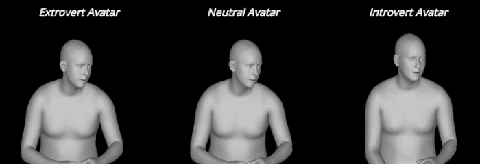
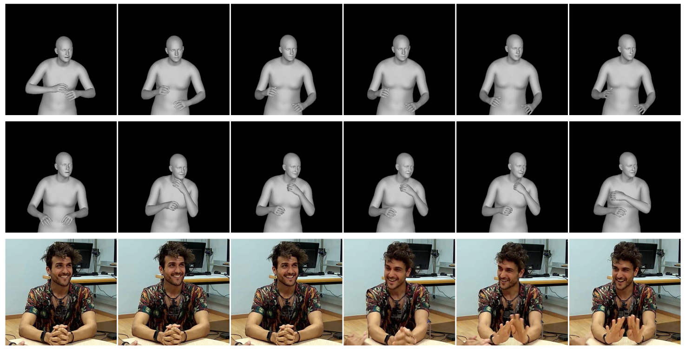
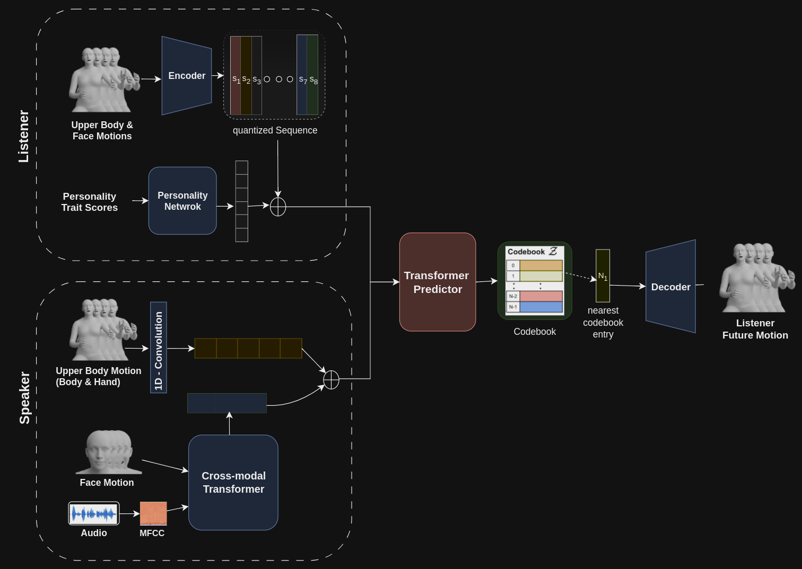

# Personality-Aware Non-verbal Behavior Generation in Dyadic Interactions

A transformer-based model that generates a listener avatar's facial expressions, hand gestures and upper-body motion in response to a speaker, conditioned on the listener's personality (extraversion).

**Amr Amer** · Master's thesis in Visual Computing, Saarland University (2024) · Research at DFKI and the Max Planck Institute for Informatics

[**Project website**](https://amramer.github.io/Personality-Aware-Non-verbal-Behavior-Generation/) | [**Thesis (PDF)**](docs/Thesis_final_doc.pdf) | [LinkedIn](https://www.linkedin.com/in/amr-amer-2023-cs/) | [Email](mailto:amribrahim.amer@gmail.com)

<p align="center">
  
  <br>
  <sub>Generated listener avatars for the same speaker, conditioned on extrovert, neutral and introvert personality scores.</sub>
</p>

## Highlights

- Generates **face, hands and upper body** together, using SMPL-X parameters extracted with PIXIE.
- **Personality conditioning**: a small network embeds the listener's extraversion score, so the same speaker input produces different listener behavior.
- **Two-stage training**: a VQ-VAE learns a discrete codebook of listener motion, then an autoregressive transformer predicts future motion tokens from speaker audio, speaker motion and the listener's past motion.
- Trained and evaluated on the **UDIVA** dyadic interaction dataset. Outperforms a personality-agnostic baseline on L2, FID and P-FID for both face and body.
- In a user study, participants correctly identified the extroverted avatar in **86%** of cases.

The [project website](https://amramer.github.io/Personality-Aware-Non-verbal-Behavior-Generation/) has the demo videos, the full method description and annotated code for every pipeline step.

## Results

Evaluated on the UDIVA test set. Lower is better for L2, FID and P-FID. Higher is better for variance (Var), which measures how much the generated motion varies.

| Model | Face L2 ↓ | Face FID ↓ | Face P-FID ↓ | Face Var ↑ | Body L2 ↓ | Body FID ↓ | Body P-FID ↓ | Body Var ↑ |
|---|---|---|---|---|---|---|---|---|
| Personality-agnostic baseline | 32.45 | 7.67 | 10.47 | 1.39 | 75.29 | 58.87 | 96.82 | 0.97 |
| Ours, joint body/face representation | 33.05 | 8.65 | 11.94 | 1.49 | 74.41 | 51.90 | 91.49 | 0.84 |
| Ours, random extraversion scores | 32.76 | 7.58 | 10.83 | **1.61** | 73.23 | 47.56 | 91.33 | **1.13** |
| **Ours** | **32.12** | **6.15** | **10.31** | 1.54 | **72.26** | **43.16** | **87.73** | 1.03 |

**User study (20 participants)**

| Task | Result |
|---|---|
| Tell the extroverted avatar from the introverted one | 86% correct |
| Prefer the personality-aware model over the baseline | 71% preferred ours |

<p align="center">
  
  <br>
  <sub>Top: introverted listener. Middle: extroverted listener. Bottom: speaker. The extroverted avatar smiles more, leans in and gestures more.</sub>
</p>

## Method

<p align="center">
  
</p>

| Component | What it does |
|---|---|
| Cross-modal transformer | Fuses the speaker's audio (mel-spectrogram) and motion into one representation using cross-attention. |
| Personality network | An MLP that embeds the listener's extraversion score into a conditioning vector. |
| VQ-VAE | Encodes listener motion into discrete tokens from a learned codebook and decodes tokens back into motion. |
| Predictor transformer | Autoregressively predicts the listener's future motion tokens from the speaker features, the personality embedding and the listener's past motion tokens. |

**Training** runs in two stages:

1. **VQ-VAE.** Learn the listener motion codebook (sequence length 32, AdamW with warm-up, about 3 days on 8 A100 GPUs).
2. **Predictor.** Train the cross-modal transformer, personality network and predictor transformer on top of the frozen codebook (learning rate 0.001, batch size 32, about 1.5 days on 8 GPUs). Training uses teacher forcing and random masking.

## Repository structure

```
├── assets/images/            Figures used in this README
├── docs/                     Thesis PDF, experiment report and topic introduction
├── site/                     Project website (deployed to GitHub Pages)
└── src/
    ├── vqgan/                Stage 1: VQ-VAE (train_vq_transformer.py, configs/, vqmodules/)
    ├── modules/              Stage 2 models
    │   ├── fact_model.py         Final personality-aware model
    │   ├── fact_model_larg_feat.py   Ablation: larger feature size
    │   ├── fact_model_pers_2.py      Ablation: separate face and body input streams
    │   └── base_models.py        Shared transformer building blocks
    ├── configs/              Stage 2 configs (conditioned and unconditioned)
    ├── utils/                Data loading, losses, optimizer schedule
    ├── train_vq_decoder.py   Stage 2 training
    ├── test_vq_decoder.py    Generate listener motion on the test set
    ├── evaluator.py          L2, FID, P-FID and variance metrics
    ├── visualize_codebook.py Codebook analysis
    └── render/               Render predictions as avatars and videos with PIXIE
```

## Getting started

The code was developed with Python 3.7 to 3.8, PyTorch and CUDA on a Slurm GPU cluster. Pretrained models are not provided, so you need to train both stages yourself.

```bash
git clone https://github.com/amramer/Personality-Aware-Non-verbal-Behavior-Generation.git
cd Personality-Aware-Non-verbal-Behavior-Generation
pip install -r requirements.txt
```

### Data

You need access to the [UDIVA dataset](https://chalearnlap.cvc.uab.es/dataset/41/description/). The preprocessing steps (segmenting speaker and listener, cropping, PIXIE motion features, mel-spectrogram audio features, smoothing) are documented with code on the [project website](https://amramer.github.io/Personality-Aware-Non-verbal-Behavior-Generation/#implementation). The training scripts expect this layout:

```
<basedir>/
├── train/
│   ├── metadata/parts_train.csv                  Personality scores (EXTRAVERSION_Z)
│   └── smoothed_final_features_id/<session>/     p0/p1 motion and audio .npy files
└── val/
    ├── metadata/parts_val_unmasked.csv
    └── smoothed_final_features_id/<session>/
```

Set `data.basedir` in the config files to your `<basedir>`.

### Train and evaluate

```bash
# Stage 1: VQ-VAE (run from src/vqgan)
cd src/vqgan
python train_vq_transformer.py --config configs/l2_32_smoothSS.json

# Stage 2: predictor (run from src). First set "l_vqconfig" in the config
# to the experiment folder created in stage 1.
cd ..
python train_vq_decoder.py --config configs/conditioned/new_model.json

# Generate listener motion. You are prompted to pick introvert, extrovert,
# neutral, actual or random extraversion scores.
python test_vq_decoder.py --config configs/conditioned/new_model.json \
    --checkpoint <path/to/model.pth> --speaker all --save

# Metrics
python evaluator.py --config configs/conditioned/new_model.json --speaker all \
    --pred <path/to/predictions.npy>
```

Use the configs in `src/configs/unconditioned/` to train the personality-agnostic baseline.

### Rendering

`src/render/demos/` turns predicted SMPL-X parameters into avatar frames and videos with PIXIE. It needs the PIXIE model files (`pixie_model.tar`, `SMPLX_NEUTRAL_2020.npz`) from the [PIXIE project](https://github.com/yfeng95/PIXIE) in `src/render/data/`.

## License

The code written for this thesis is released under the [MIT License](LICENSE). Third-party code in this repository keeps its own license:

- `src/render/pixielib/` is from [PIXIE](https://github.com/yfeng95/PIXIE) (Max Planck Institute for Intelligent Systems) and is for non-commercial research use only. See the PIXIE license.
- The Fréchet distance computation in `src/evaluator.py` is adapted from code by the Institute of Bioinformatics, JKU Linz, under the Apache License 2.0.

The UDIVA dataset is subject to its own license terms and is not included.

## Citation

```bibtex
@mastersthesis{amer2024personalityaware,
  title  = {Personality-Aware Non-verbal Behavior Generation in Dyadic Interactions},
  author = {Amer, Amr},
  school = {Saarland University},
  year   = {2024},
  type   = {Master's Thesis}
}
```
